<!-- Generated by scripts/render_math.mjs from docs/sources/THEORY.md.in. Edit the template, then rebuild. -->

# Mathematical statements and complete proofs

These derivations restate and expand the supplied SAGE author manuscript. Equations are displayed as scalable vector images; the [complete editable LaTeX source](sources/THEORY.md.in) and a [notation and viewing guide](MATH_RENDERING.md) are provided. They are mathematical proofs under stated hypotheses; the supplied floating-point artifacts do not independently establish the interval hypotheses.

## 1. Domain and regularity

Let  be compact with , and let the closed-loop vector field 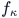 be locally Lipschitz on an open neighborhood of , with 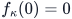. Write  for this fixed closed-loop field below. The subscript on  denotes a fixed controller and is independent of the scalar coupling strength used in Section 7.

Let 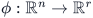 be  and let . Define

**Equation (T1)**

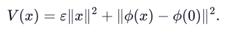

Every norm on a vector is Euclidean; every matrix norm is its induced 2-norm unless another norm is explicitly written. For radial Jacobian arguments, require 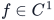 on a neighborhood of each radial hull under consideration. The benchmark square is star shaped; for a general non-star-shaped , the field must also be defined on the portions of the radial hull outside .

## 2. Positive definiteness and regularity — manuscript Theorem 3

**Statement.** , 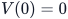, 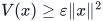, and 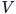 is radially unbounded.

**Proof.** A squared norm is a finite sum of squares of its components. Composition and finite sums of  functions remain . At the origin both terms in (T1) vanish. For 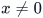, the first term is positive and the second is nonnegative. Finally 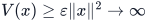 as . ∎

Differentiating (T1) gives

**Equation (T2)**

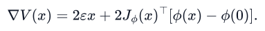

## 3. Radial enclosure — manuscript Lemma 1

For an axis-aligned box 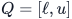, define

**Equation (T3)**

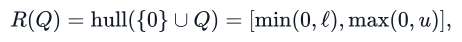

where the minimum and maximum act componentwise. For all 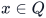 and 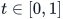, 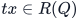. The fundamental theorem of calculus gives

**Equation (T4)**

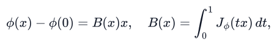

**Equation (T5)**

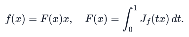

**Statement.** If interval matrices 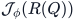 and 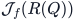 enclose the respective Jacobians everywhere on 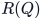, then they enclose 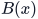 and 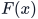 for every . Sound interval operations applied to

**Equation (T6)**

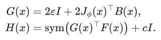

also enclose 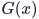 and 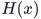. Here 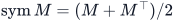 and .

**Proof.** Fix an entry 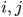. Its value in (T4) is the integral average of a continuous scalar function whose entire range is in the interval 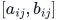. Integration of 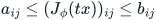 over an interval of length one preserves these inequalities. This proves entrywise inclusion of ; the same argument proves inclusion of . The endpoint Jacobian 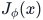 can be bounded on  itself. Interval addition and multiplication that enclose their exact real results preserve these inclusions in (T6), even when dependency makes the result wider. ∎

For two tanh layers, 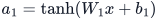, 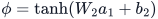,

**Equation (T7)**

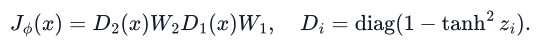

For the **main exported model**, the final activation is the identity, so 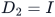. The supplementary stress-test model uses both tanh layers. On a scalar interval 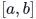,  is monotone, and the minimum of 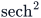 occurs at the endpoint with largest absolute value. Its maximum is one if 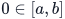, otherwise it occurs at the endpoint closest to zero. All these endpoint evaluations require validated rounding when used in a machine proof.

## 4. Box-wise decrease — manuscript Theorem 2

Define the prescribed margin

**Equation (T8)**

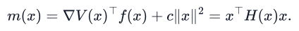

**Statement.** Suppose a sound interval matrix encloses  for every  and a sound scalar upper bound satisfies 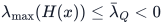 throughout . Then

**Equation (T9)**

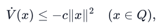

with a strictly negative margin for every nonzero .

**Proof.** From (T2), (T4), and (T6), ; from (T5), 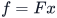. The quadratic form of a skew-symmetric matrix is zero, so (T8) follows. The Rayleigh quotient for the symmetric matrix  yields 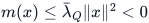 for . At zero both sides of (T9) are zero. Subtracting 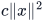 proves the result. ∎

For a symmetric interval matrix with diagonal upper endpoints 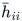 and off-diagonal ranges 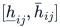, Gershgorin gives

**Equation (T10)**

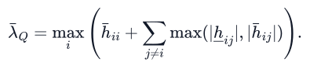

The maximum and the sums must also be bounded outward. A finite partition covering  proves (T9) on  if every leaf is discharged soundly. Away from zero, a direct interval evaluation with 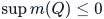 also suffices. A finite grid or partition geometry alone does not prove the inequality.

### Benchmark-specific factorization and the general Jacobian

For 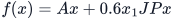, the archived verifier uses the exact factorization

**Equation (T11)**

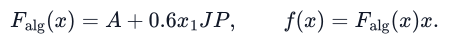

This is sufficient for (T8) and avoids a looser enclosure. It need not equal the radial integral in (T5). The actual vector-field Jacobian is

**Equation (T12)**

and its radial integral is . Multiplication of either factor by  gives the same . In a general application, (T11) must not be substituted for the Jacobian; the omitted product-rule term matters.

### Quadratic upper and gradient bounds

If  and  on , then

**Equation (T13)**

The first inequality follows by (T1) and (T4); the second follows from . A matrix interval  admits the conservative norm bound  with . These computations require sound arithmetic if their outputs support a proof.

## 5. Invariant sublevel and exponential estimate — manuscript Corollary 1

**Statement.** Suppose on 

**Equation (T14)**

where . Let  and let the complete sublevel  be contained in . Every solution with  exists for all , remains there, and satisfies

**Equation (T15)**

**Proof.** The sublevel is closed and bounded by (T1), hence compact. On its boundary , so  and . A trajectory cannot exit to a larger value of . More explicitly, integrating the differential inequality up to a first possible exit gives ; a boundary trajectory immediately decreases, which rules out that exit. The solution therefore stays in a compact subset of the open existence domain. Local Lipschitz continuity and the standard continuation theorem preclude finite-time termination there. Since , . Integrating gives . Apply the lower bound at  and the upper bound at zero and take square roots. ∎

For  and , every point on or outside its boundary has . Thus  follows **architecturally**. Invariance additionally requires the derivative inequality on that set; the numerical guarded calculation does not by itself prove it.

## 6. Structured robustness — manuscript Proposition 1

**Statement.** Assume (T14),  on , and a locally Lipschitz perturbed field

**Equation (T16)**

For a complete sublevel , the perturbed system is forward invariant there and

**Equation (T17)**

**Proof.** Cauchy–Schwarz and the induced matrix norm give

The preceding invariance, continuation, and comparison proof applies with  in place of . ∎

The manuscript treats  as a nonnegative perturbation magnitude. The absolute value in (T16) explicitly extends that convention to signed . More generally  gives the reduced coefficient  under the same existence assumptions.

## 7. Two coupled subsystems — manuscript Proposition 2

**Statement.** Suppose (T14) and the gradient bound hold on . Consider

**Equation (T18)**

where . Set  and . Then on 

**Equation (T19)**

If  and , this sublevel is forward invariant and, for ,

**Equation (T20)**

**Proof.** Set , . The isolated terms sum to at most . By the gradient bound and triangle inequality, the two coupling terms sum to at most

This proves (T19). Sum the two quadratic bounds in (T14), and apply the proof of Section 5 to the joint state and . ∎

This is a sufficient bound for two identical diffusively coupled systems, not a general graph or ISS small-gain theorem. For the benchmark, the same floor implies .

## 8. Independent analytical benchmark identities

### Calibration system

**Equation (T21)**

Direct multiplication gives . The leading minor  and determinant  show . For  and the field in (T11),

**Equation (T22)**

The last term vanishes because . This is a global analytical certificate and is stronger than sampled evidence for a learned candidate.

### Non-polynomial reference

For , , define

**Equation (T23)**

It is positive definite, smooth, and radially unbounded. Differentiation and completion of squares yield

**Equation (T24)**

All terms in the numerator are nonnegative, and  off the origin. Proper sublevels and the same continuation argument give global asymptotic stability. The claim that this polynomial vector field admits no global polynomial Lyapunov function is a cited result, not proved here: Ahmadi, Krstic, and Parrilo, CDC 2011, [doi:10.1109/CDC.2011.6161499](https://doi.org/10.1109/CDC.2011.6161499). A compact-domain neural experiment does not itself establish that global obstruction.

## 9. Numerical event and binomial bound

Fix the selected network before generating the test sample. Let  be IID uniform on  and define

**Equation (T25)**

The numerical implementation, precision, and tolerances are part of the experiment. The deterministic grid is excluded from the binomial trial count. If , independence gives . Inverting this probability at  gives the exact one-sided zero-event Clopper–Pearson upper confidence endpoint

**Equation (T26)**

At , , . This is a repeated-sampling confidence statement about the declared numerical event under this distribution. It does not bound the exact event , does not transfer automatically to another distribution, and does not imply continuum verification. With nonzero event counts, the zero-event formula must not be used.

## 10. Hard and soft CLF filters

For control-affine , the hard filter minimizes  over  subject to . If feasible throughout the operating set and the resulting dynamics admit solutions to which the derivative inequality applies, the same comparison proof establishes decay.

The soft filter adds , a penalty , and allows . Positive slack by itself does not imply strict decrease: it only gives the stated upper bound. A further bound such as  with  would recover a reduced rate. Neither filter's numerical implementation is part of the supplied benchmark experiments; they are control-use formulations.
